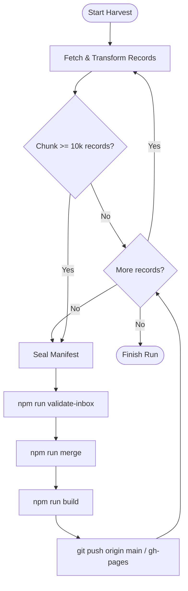

# Universal Harvester Developer & Architecture Guide

> **Authoritative Specification & Implementation Blueprint for Autonomous Agents and Engineers Building Library Harvesters in Pustaka Terbuka.**

---

## 1. Executive Summary & Purpose

Pustaka Terbuka is the open national union catalog (*Katalog Induk Kebangsaan*) for Malaysian public, academic, and school libraries. To aggregate millions of bibliographic records across diverse institutions—including Perpustakaan Negara Malaysia (PNM), state public library corporations (*Perbadanan Perpustakaan Awam Negeri* such as PPAPP, PPAS, PPAP), and academic universities (UM, UKM, USM, UTM, UiTM)—the ecosystem employs **decoupled, polite, self-healing harvesters**.

This document defines the **universal architecture, behavioral invariants, and adapter design patterns** required for all harvesters in the ecosystem. Every new harvester—regardless of programming language (Node.js or C#/.NET) or source OPAC software (Koha, Vega, Alma, SirsiDynix, Spydus)—must adhere strictly to this specification.

---

## 2. Core Invariants & System Contracts

Whenever you build, test, or run a harvester, you must maintain these four foundational invariants:

1. **Raw As Received (No Early Deduplication):**
   - Harvesters must capture bibliographic metadata exactly as exposed by the source library.
   - **Never** perform title deduplication, ISBN normalization, or cross-institutional merges inside the harvester. Deduplication is handled exclusively downstream by `tools/merge.js`.
2. **100% Tag Preservation:**
   - Preserve all original control and cataloging tags:
     - `001`: Original ILS control number / system ID (e.g. `vtls000437338`, Koha `biblionumber`).
     - `035`: System control numbers and OCLC identifiers.
     - `020` / `022`: ISBN and ISSN values (preserve raw text including subfields `$q` for qualifiers).
     - `040`: Original cataloging agency code (e.g. `MY-KLP`, `PPAPP`, `DLC`).
     - `082` / `090` / `852`: Dewey Decimal (DDC) and Library of Congress (LCC) classifications and call numbers.
     - `9xx`: Local provenance and item tags.
3. **Deterministic Output Layout:**
   - Every harvester run emits a standardized folder structure into the ingestion inbox:
     ```text
     harvest/inbox/<source-code>/<run-id>/
     ├── manifest.json
     ├── partition_state.json
     ├── provenance.jsonl
     └── records/
         ├── batch_0.xml
         ├── batch_1.xml
         └── ...
     ```
4. **Tombstone & Takedown Compliance:**
   - Harvesters must check `data/tombstones.json` before writing records. Any catalog item previously removed for legal, copyright, or privacy reasons must be silently skipped to prevent resurrecting deleted items.

---

## 3. The Universal Output Contract

### 3.1 `manifest.json` Specification
The run manifest records batch metadata, execution status, and record counts.

```json
{
  "schema_version": "1.0",
  "source_code": "ppapp",
  "source_name": "Perbadanan Perpustakaan Awam Pulau Pinang",
  "source_base_url": "https://opac.penanglib.gov.my/",
  "terms_url": "https://penanglib.gov.my/terms",
  "terms_verified_on": "2026-10-11",
  "harvester_name": "ppapp-koha-harvester",
  "harvester_version": "1.0.0",
  "run_id": "20261011-060000Z",
  "mode": "full",
  "started_at": "2026-10-11T06:00:00.000Z",
  "finished_at": "2026-10-11T07:15:30.000Z",
  "record_count": 10000,
  "error_count": 0,
  "status": "complete",
  "user_agent": "PustakaTerbuka-Harvester/1.0 (+https://github.com/pustaka-terbuka/ppapp; contact@pustakaterbuka.org)",
  "notes": "Initial full harvest batch"
}
```

* Status values:
  * `"complete"`: All requested pages/records harvested without unrecoverable errors.
  * `"partial"`: Harvest stopped early (e.g. user interrupt, network failure) with $\ge 1$ valid record saved.
  * `"failed"`: Fatal failure before any valid record could be stored.

### 3.2 `records/batch_<n>.xml` Specification
* **Format:** Standard MARC 21 Slim XML wrapping records in `<collection xmlns="http://www.loc.gov/MARC21/slim">`.
* **Encoding:** UTF-8 without Byte Order Mark (BOM).
* **Batch Sizing:** 100 to 1,000 records per XML file (keeps memory low and Git diffs small).
* **Validation Gate:** Every record must contain at least a valid **Control Number (`001` or `035`)** and a **Title (`245 $a`)**. Missing either marks the record as invalid (`error_count` incremented, record discarded).

### 3.3 `provenance.jsonl` Specification
Every record in `records/*.xml` has a corresponding JSON line in `provenance.jsonl` linking the record to its live source URL and harvest timestamp:

```json
{"source_001":"1029384","source_url":"https://opac.penanglib.gov.my/cgi-bin/koha/opac-detail.pl?biblionumber=1029384","harvested_at":"2026-10-11T06:01:23.100Z","file":"batch_0.xml","index":0}
```

---

## 4. Architectural Patterns for Library Adapters

Harvesters should use a **Strategy Pattern** separating the **Universal Runtime Engine** (rate limiting, retry loop, batch writing, resume machine) from the **Source Adapter** (protocol communication and data transformation).

```
┌────────────────────────────────────────────────────────┐
│             Universal Harvester Base Engine            │
│   (Rate Limiter, Retries, Checkpointer, Batch Writer)  │
└───────────────────────────┬────────────────────────────┘
                            │ Calls adapter methods
     ┌──────────────────────┼──────────────────────┐
     ▼                      ▼                      ▼
┌──────────────┐     ┌──────────────┐     ┌──────────────┐
│  Pattern A:  │     │  Pattern B:  │     │  Pattern C:  │
│   OAI-PMH    │     │   REST API   │     │  Partition   │
│   Adapter    │     │   Adapter    │     │   Crawler    │
│ (Koha, Alma) │     │(Vega, Primo) │     │ (Web OPACs)  │
└──────────────┘     └──────────────┘     └──────────────┘
```

### Pattern A: OAI-PMH (Preferred for Koha, Alma, DSpace)
* **When to use:** When the institution's ILS exposes an open OAI-PMH endpoint (common in Koha instances at `https://<domain>/cgi-bin/koha/oai.pl`).
* **Protocol Flow:**
  1. `Identify`: Verify repository name, admin email, and protocol version.
  2. `ListMetadataFormats`: Confirm support for `marc21` or `marcxml`.
  3. `ListRecords`: Request records with `metadataPrefix=marc21`.
  4. Pagination is built-in: Extract `<resumptionToken>` from each response and request subsequent pages until the token is empty.
* **Advantages:** Native MARC 21 format, official institutional protocol, zero HTML scraping needed.

### Pattern B: REST API (Vega Discover, Ex Libris Alma, Modern ILS)
* **When to use:** When the library provides a JSON-based REST API for discovery search (e.g., PNM Vega Discover).
* **Protocol Flow:**
  1. Construct query payload with `pageNum` and `pageSize` (typically 50-100 items).
  2. Send `POST` or `GET` with required customer domain and host headers.
  3. Iterate through JSON `data` array and transform JSON objects into MARC 21 Slim XML fields.
* **Transformation Matrix:**
  * Map identifiers &rarr; `001`, `020`, `022`, `035`.
  * Map title/agent/dates &rarr; `100`, `245`, `264`.
  * Map subjects & formats &rarr; `650`, `655`.
  * Map call numbers & locations &rarr; `852`.

### Pattern C: Query Partition Crawler (Closed Web OPACs)
* **When to use:** When no OAI-PMH or REST API exists, and the search interface enforces a pagination ceiling (e.g. OpenSearch 10k window).
* **Protocol Flow:**
  1. **Partitioning:** Subdivide the catalog into bounded search queries:
     * By publication year (e.g. `2024`, `2023`, ...).
     * By alphanumeric prefix (e.g. `a*`, `b*`, ... `z*`, `0*` - `9*`).
     * By broad era ranges for older accessions.
  2. Each query is treated as a separate partition tracking pages `0` through `maxPage`.
  3. Harvested search results link directly to item detail pages or MARC view endpoints.

---

## 5. Operational Guarantees & Network Etiquette

All harvesters must behave as model citizens on institutional library networks:

1. **Politeness Delay:**
   * Minimum delay of **2,000 ms** between requests to external hosts.
   * Delay must be configurable via `--delay <ms>`.
2. **Descriptive User-Agent:**
   * Format:
     ```text
     PustakaTerbuka-Harvester/1.0 (+https://github.com/pustaka-terbuka/<source>; contact@pustakaterbuka.org)
     ```
3. **Exponential Backoff with Jitter:**
   * On HTTP `429`, `502`, `503`, `504`, or socket timeout:
     $$\text{Backoff (ms)} = \min\left(300000,\, 5000 \times 2^{\text{attempt}-1}\right) + \text{random}(0, 2000)$$
   * Retry up to 5 times before halting.
   * If a `Retry-After` header is returned by the server, respect that delay exactly.
4. **Circuit Breaker:**
   * If an endpoint returns continuous failures across 10 consecutive retry cycles, the harvester marks the run status as `"partial"`, seals `manifest.json`, and exits cleanly with exit code `1`.
5. **Stateful Checkpointing & Self-Healing:**
   * All progress is tracked in `partition_state.json`.
   * On startup with `--resume`:
     * Scan existing `records/batch_*.xml`.
     * If a file does not contain a closing `</collection>` tag, delete it.
     * Scrub matching entries from `provenance.jsonl`.
     * Set the next batch counter to `highest_valid_batch + 1`.

---

## 6. Discrete 10k Chunk Pipeline & Ephemeral Mode

For collections exceeding 10,000 records, harvesters should support chunked lifecycle processing:



* **Ephemeral Scratch Mode (`--ephemeral`):**
  * Shallow clones the target repo (`--depth 1`) in a temporary directory.
  * Harvests, validates, merges, and pushes from scratch space.
  * Purges the scratch directory upon completion, leaving 0 MB of persistent local disk footprint.

---

## 7. Step-by-Step: Adding a New Library Harvester

Follow this standard procedure when introducing a new library source (e.g. PPAPP):

### Step 1: Register Source in `master/data/sources.json`
Add the organization entry with priority and repo coordinates:
```json
"ppapp": {
  "name": "Perbadanan Perpustakaan Awam Pulau Pinang",
  "prefix": "PPAPP",
  "priority": 8,
  "organization": "PPAPP",
  "repository": "https://github.com/pustaka-terbuka/ppapp",
  "localPath": "../ppapp",
  "dataPath": "../ppapp/data",
  "opacUrl": "https://opac.penanglib.gov.my/",
  "adapter": "koha-oai"
}
```

### Step 2: Implement the Harvester
Create `tools/harvesters/<source-code>/harvester.js` (or `.cs`). Wire CLI options:
* `--max-pages <n>`
* `--page-size <n>`
* `--delay <ms>` (default 2000)
* `--mode <full|incremental>`
* `--resume [auto|id]`
* `--fresh`

### Step 3: Run Unit & Ingestion Tests
Create `tests/harvester-<source-code>.test.js` validating:
1. XML escaping and UTF-8 output.
2. MARC 21 structure and required fields (`001`, `245 $a`).
3. Resumption and corruption self-healing logic.

### Step 4: Verify with Ingestion Gate
```bash
node tools/validate-inbox.js harvest/inbox/<source-code>/<run-id>/
```
Ensure exit code is `0` and all integrity checks pass.
